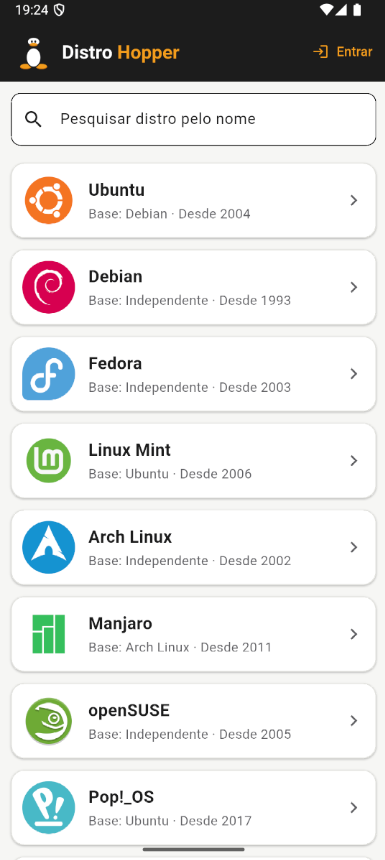
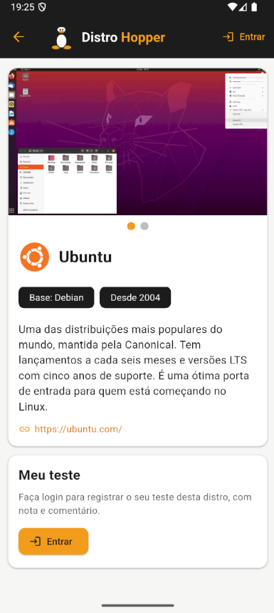
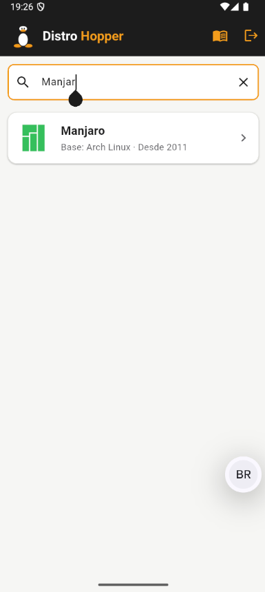

# Distro Hopper

Diário de testes de distribuições Linux, desenvolvido em **Flutter/Dart**.

- **Desenvolvedora:** Helen Santos

## O que é "Distro Hopper"?

No mundo Linux, **distro hopping** é o hábito de ficar trocando de distribuição: a pessoa instala uma, usa por um tempo, experimenta outra, e assim por diante, em busca da que melhor combina com ela. Quem faz isso é chamado de **distro hopper**, literalmente "pulador de distros".

Como quem testa muitas distros costuma esquecer o que achou de cada uma, o app funciona como um **diário desse caminho**: registra por onde a pessoa já passou, com nota, comentário, ambiente gráfico e versão. O mascote do app é o **Tux**, o pinguim do Linux, e as cores do tema vêm dele (preto, branco e laranja).

## Capturas de tela

<table>
  <tr>
    <td align="center"></td>
    <td align="center"></td>
    <td align="center"></td>
  </tr>
  <tr>
    <td align="center"></td>
    <td align="center"></td>
    <td align="center"></td>
  </tr>
</table>

## Sobre o app

- **Sem login (visitante):** navega pela lista de distros, pesquisa pelo nome e vê os detalhes de cada uma.
- **Com login (mockado):** marca distros como testadas, avalia (1 a 5 estrelas), escreve comentários, informa ambiente gráfico e versão, e acessa a tela **Meus testes**. Uma mesma distro pode ter vários testes.

### Contas fictícias

O login é simulado (sem servidor). Ao tocar em **Entrar**, escolha uma das contas:

| Conta | E-mail |
|---|---|
| Linus Pinguim | linus.pinguim@distrohopper.com |
| Tuxa Silva | tuxa.silva@distrohopper.com |

Cada conta enxerga apenas os seus próprios testes.

## Telas

1. **Distros:** lista de distros com barra de pesquisa por nome.
2. **Detalhes:** capturas de tela, informações da distro e formulário de novo teste (para quem está logado) com o histórico de testes daquela distro.
3. **Meus testes:** lista dos testes da conta logada, do mais recente para o mais antigo.

## Tecnologias

- Dart e Flutter
- `provider` (gerenciamento de estado)
- `intl` (formatação de datas)
- `page_view_dot_indicator` (indicador do carrossel de imagens)
- Dados simulados com arquivos **JSON estáticos** (`recursos/jsons/`)

## Estrutura do projeto

```
lib/
├── main.dart                  # app e troca de telas
├── gerenciador_estado.dart    # estado do app (telas, usuário, testes)
├── autenticador.dart          # login/logout mockado (duas contas)
├── usuario.dart
├── repositorio.dart           # leitura dos JSONs
├── tema.dart                  # tema com as cores do Tux
├── modelos/                   # Distro e Teste
├── telas/                     # distros, detalhes, meus_testes
└── componentes/               # cartões, formulário, estrelas, barra do app...
recursos/
├── jsons/                     # distros.json e testes.json
└── imagens/                   # tux.png, logos/ e capturas/
```

## Como executar

### Pré-requisitos

- Flutter instalado (o projeto usa o SDK definido em `pubspec.yaml`)
- Versão usada no desenvolvimento: Flutter 3.47.2 (canal stable) com Dart 3.13.2

### Passos

```bash
git clone https://github.com/sunHelen12/distro_hopper.git
cd distro_hopper
flutter pub get
flutter run
```

O `flutter run` usa o dispositivo disponível. Para escolher onde rodar:

```bash
flutter devices
flutter run -d <id>
```

- **Emulador Android:** inicie o emulador e rode `flutter run`.
- **Desktop Linux:** `flutter run -d linux`
- **Navegador:** `flutter run -d chrome`

### Como o app foi executado no vídeo

O app foi executado no **emulador Android (Medium Phone)**, **sem usar o Android Studio**: o Android SDK e o emulador foram usados apenas pela linha de comando (terminal), em Linux.

Comandos usados para iniciar o emulador e rodar o app:

```bash
# deixa o adb e o emulador acessíveis no terminal
export PATH="$PATH:$HOME/Android/Sdk/platform-tools:$HOME/Android/Sdk/emulator"

# reinicia o servidor do adb
adb kill-server
adb start-server

# lista e inicia o emulador (boot a frio)
flutter emulators
flutter emulators --launch <id_do_emulador> --cold

# confirma que o emulador aparece como "device" e roda o app
adb devices
flutter run
```

Quem preferir o Android Studio pode abrir a pasta do projeto, executar **Pub get**, escolher um emulador e rodar o `lib/main.dart`. É o mesmo processo, só que pela interface.

## Observações

- Os testes cadastrados durante o uso ficam **apenas em memória**. Ao reiniciar o app, os dados voltam ao conteúdo de `recursos/jsons/testes.json`, já que os JSONs são estáticos.
- Se alguma imagem de logo ou captura de tela não existir, o app mostra um ícone no lugar e continua funcionando.
- O logo do Tux é um desenho simplificado feito para este projeto.